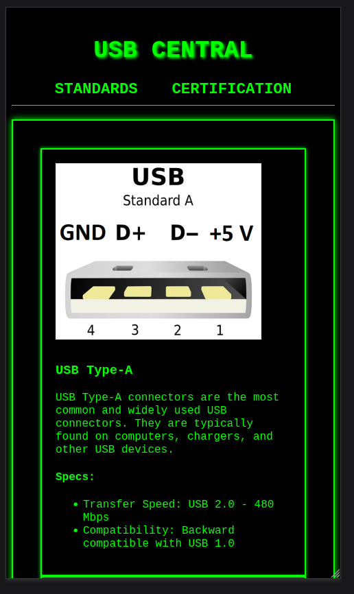

# Media Queries

- [Media Queries](https://developer.mozilla.org/en-US/docs/Web/CSS/Media_Queries/Using_media_queries) - MDN Web Docs

- [CSS Media Queries](https://www.w3schools.com/css/css_rwd_mediaqueries.asp) - W3Schools

## Kids Be On They Phones

Global web traffic by device. Remember, most servers/bots are desktop, so the actual number of mobile users is likely higher than this data suggests.

- [Global web traffic by device](https://gs.statcounter.com/platform-market-share/desktop-mobile/)

Most of your market is on mobile, so you need to make sure your website is mobile friendly.

### Mobile First

Most website designers and developers are now using a mobile-first approach to web design. This means that you should design your website for mobile devices first, and then use media queries to adjust the layout for larger screens.

- [Reddit Mobile First]()e

## Websites that are not mobile friendly

I couldn't fine many websites that are not mobile friendly, but here are a few that I found:

- [Weather.gov](https://www.weather.gov/)

## Example

Build the USB Example

