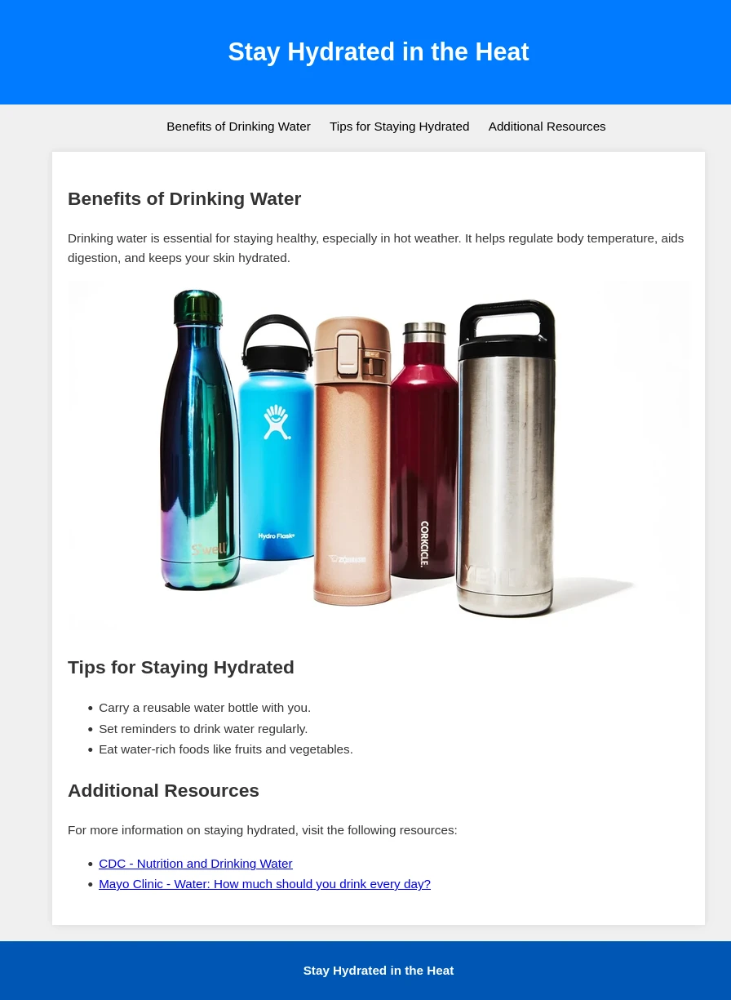
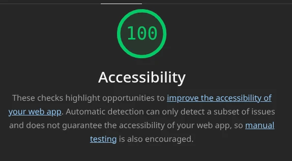

# Into to Web Accessibility

## What is Web Accessibility

- [Video](https://www.youtube.com/watch?v=3f31oufqFSM)
- [Intro to Web Accessibility](https://www.w3.org/WAI/fundamentals/accessibility-intro/#context)
    - https://www.w3.org/WAI/tips/designing/

## Accessibility Everywhere

- [In gaming](https://www.xbox.com/en-US/accessories/controllers/xbox-adaptive-controller)
- [In the sheets](http://www.apsguide.org/index.cfm)
- [In plain sight](https://en.wikipedia.org/wiki/Braille)

## How can we make sure our websites are Accessibility

- [HTML Accessibility](https://www.w3schools.com/html/html_accessibility.asp)
- [ARIA](https://developer.mozilla.org/en-US/docs/Web/Accessibility/ARIA)
    - [Why you should start using ARIA Attributes in HTML](https://www.youtube.com/watch?v=JP2VkfYF5HU)
- Show off Chrome and Firefox Accessibility tools
    - For Chrome it's called Lighthouse

## HTML Example Activity

- Download Accessability Starter
- Complete all the TODO in the `index.html` and `style.css` files.
- Check the site with the Chrome Lighthouse tool and see if you can get a perfect score.

