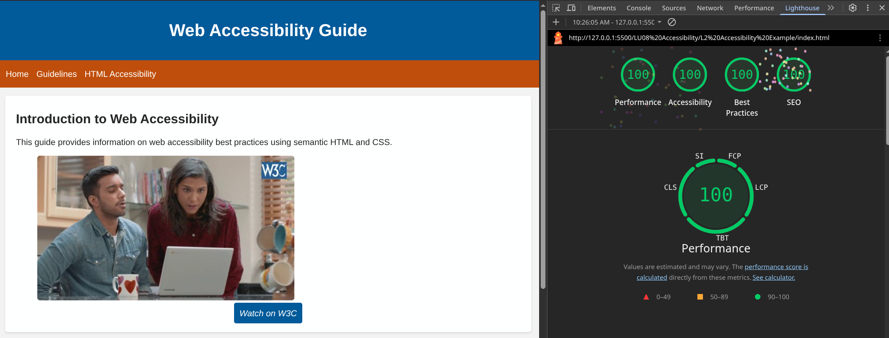

# Continued review of Web Accessibility

## SEO

How do people find your website?
Well unless they type in the URL directly, they will most likely find your website through a search engine like Google or Bing.
These search engines rank your website based based on a number of factors, one of which is accessibility.

To play the game to get to the top of the search results is called Search Engine Optimization or SEO for short.

- [SEO Starter](https://developers.google.com/search/docs/fundamentals/seo-starter-guide)

This could be a whole course in itself!

## Web Accessibility Example

Download images assets from blackboard and build the following web page.

- [Finished-Example](index.html)

