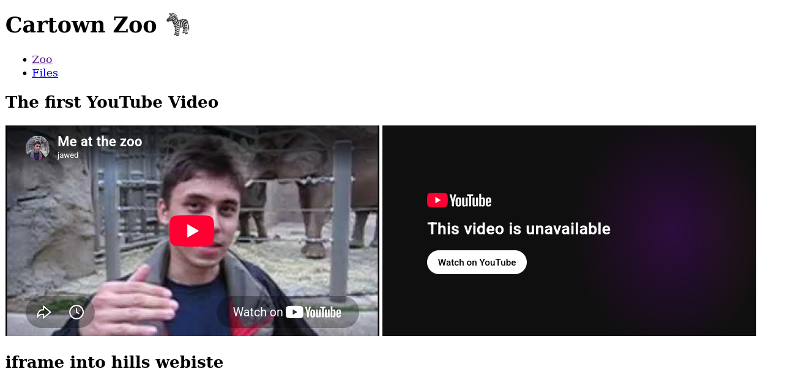

# LU09 Multimedia

This example shows off `<iframe>`s and embedded media like video and audio.


## Get Starter Code

Download the Starter code this should include a `.pdf`, `.mp3.` and a `.mp4`

## Build the Project

Follow the file structure below using this that you just downloaded.

```
├── multimedia-embeds
│   ├── assets
│   │   ├── Apply Now.mp4
|   |   ├── coloring.pdf
|   ├── index.js
|   ├── files.html
```

## Develop the Site

Below is a list of resources that might be helpful during the lecture.

- Docs about[`<iframe>`](https://developer.mozilla.org/en-US/docs/Web/HTML/Element/iframe)
- [link](https://youtu.be/XAJEXUNmP5M) to YouTube video we will add to our site
- Docs about [video](https://developer.mozilla.org/en-US/docs/Web/HTML/Element/video) on the web
- [Game](https://play2048.co/) we will add to our site
- [OLD way to include games]()
- [Audio](https://developer.mozilla.org/en-US/docs/Web/HTML/Element/audio) docs. Make sure to read the note about auto play
- [How To Create a Download Link](https://www.w3schools.com/howto/howto_html_download_link.asp)


